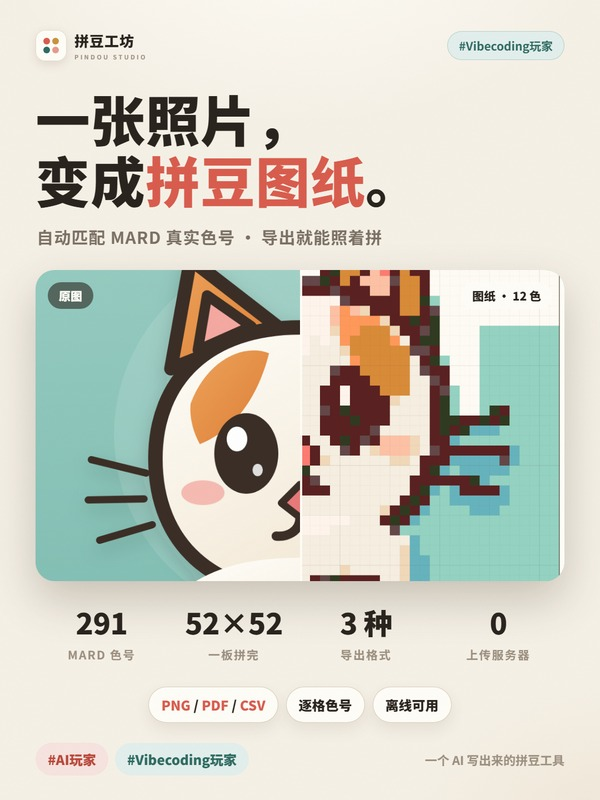
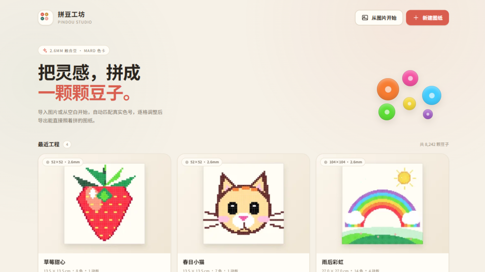
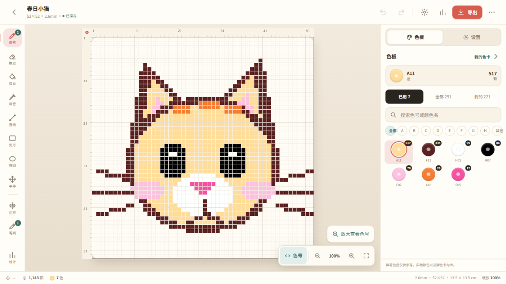
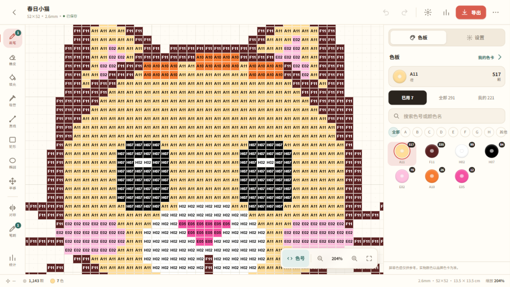
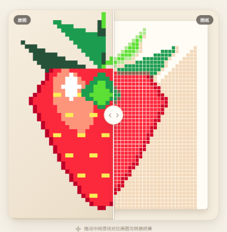
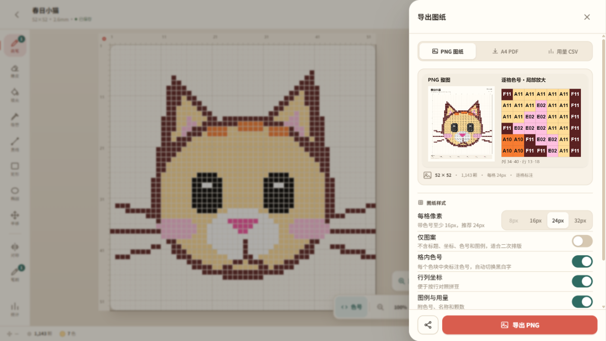

# 拼豆工坊

手机 / 平板优先的拼豆图纸工具。从空白或图片开始，自动匹配 MARD 真实色号，逐格修改后导出可以照着拼的图纸。

所有工程、我的色卡和偏好都保存在本机 IndexedDB，不上传服务器；构建产物是可离线使用的 PWA。

<p align="center">
  
</p>

## 界面预览

<p align="center">
  
</p>
<p align="center"><sub>首页：最近工程、缩略图、总颗数，以及「从图片开始 / 新建图纸」入口</sub></p>

<p align="center">
  
  
</p>
<p align="center"><sub>左：整图编辑、色板与用量统计；右：放大后每个色块中央显示 MARD 色号</sub></p>

<p align="center">
  
  
</p>
<p align="center"><sub>左：图片转图纸的原图 / 图纸滑动对比；右：PNG 图纸导出，含逐格色号、坐标和图例</sub></p>

## 功能

- **工程**：新建空白图纸、首页最近工程、缩略图、重命名、复制、删除、`.pindou.json` 导入/导出备份。
- **画布**：画笔、橡皮、填充、吸管、直线、矩形、椭圆、平移；笔刷 1–3 格、水平/垂直/四向对称；60 步撤销重做；滚轮/双指缩放、单指绘制、双指平移。
- **色卡**：内置 MARD 291 色（221 常用色 + 70 特殊效果色）；默认「我的色卡」为 221 色，可切换 291 色、按系列勾选或粘贴色号清单自定义。
- **图片转图纸**：选图、裁剪/缩放/旋转、亮度/对比度/饱和度、背景移除、最多色数、抖动、原图/图纸对比，可替换当前画布（可撤销）或新建工程。默认 12 色、保色匹配、4×4 锐利采样：高对比格子优先保留深色线稿、眼睛高光和紫色/金色等高彩度点缀，低对比区域才做面积平均。默认开启**自动配色**：每次导入都从当前图片的像素分布重新聚类主色（OKLab 加权 k-means，固定保护最深、最浅、最高彩度三类颜色），再映射到 MARD 色卡；换图会重新计算，不会沿用上一张的色号。面积小但关键的黑色眼睛、白色高光、粉色/金色点缀不会被大面积主色挤掉。关闭自动配色时退回「先匹配全部色卡、再按用量保留」的旧逻辑。近色合并默认关闭；背景移除只删除与图片外边缘连通的区域，默认容差 2%，白底白发的内部区域会保留。导入带透明留白或纯色背景留白的图片时，还会自动按主体边界取景，主体铺满画布，也可手动拖动或点「自动取景」重算。量化在 Web Worker 中执行。
- **画布内设置**：编辑页右侧新增「色板 / 设置」标签，集中修改画布尺寸、豆径与板型、色号/网格显示、我的色卡、内部空白修复、翻转/旋转、替换颜色和清空，改完立即生效。
- **空白修复**：设置中提供「补全内部空白」，用周围豆子的颜色补回被误删的封闭区域，操作可撤销。
- **统计与导出**：PNG 图纸（默认逐格标注色号与坐标，可关或仅图案）、A4 PDF（适配/1:1/自定义比例，自动均衡分页，重叠边、镜像、格内色号、单页用量面板或多页图例，格内色号随打印精度缩放）、用量 CSV（UTF-8 BOM，Excel 直接打开）。
- **PWA**：可安装，离线二次打开；新版本提示后保存并更新。

## 开发

```bash
npm install
npm run dev        # http://127.0.0.1:5173
npm run test:run   # 单元测试
npm run typecheck
npm run build      # 类型检查 + 生产构建（含 Service Worker）
npm run preview    # 预览生产构建
```

部署到 HTTPS 后即可安装为 PWA；`localhost` 在开发时视为安全上下文。

## 数据与备份

- 数据库名 `pindou`，存储工程网格、摘要/缩略图、我的色卡与偏好。
- 首次保存时会静默请求持久化存储，但系统仍可能清理站点数据。重要图纸请用首页的「导入工程文件 / 工程菜单 → 导出工程文件」备份。
- 屏幕 HEX 只作预览参考，实物颜色请以 MARD 实体色卡为准。

## 目录

```
src/
  core/       数据模型、色卡、OKLab 匹配、量化、几何、分页、工程文件
  editor/     Canvas 2D 编辑器引擎与手势/工具
  features/   首页、编辑器、图片导入向导
  rendering/  共用格内色号绘制（画布 / PNG / PDF）
  export/     PNG / A4 PDF / CSV / 缩略图
  storage/    IndexedDB 仓储与自动保存
  workers/    图片量化 Worker
  app/        应用外壳、PWA 更新提示
design/       设计稿、交互原型与设计规范
docs/         架构文档与 ADR
public/       PWA 图标
```
